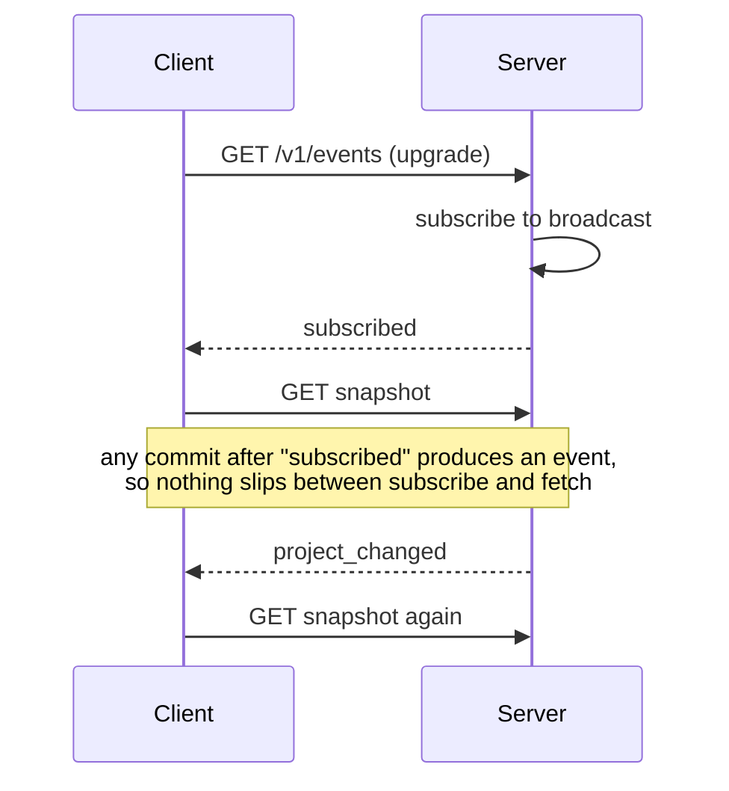

# Building story

Each entry says what got built, how it works, and why it ended up that way.
Decision records live in [decisions.md](decisions.md).

## Step 1: workspace and a real GPUI window

The single `hyakume` package became a Cargo workspace with six crates. Only
`hyakume-desktop` depends on GPUI.

```text
crates/
├── hyakume-core/      # domain types, rules, /v1 wire types; no I/O
├── hyakume-storage/   # SQLite schema, migrations, queries (SQLx)
├── hyakume-client/    # local + remote workspaces behind one interface
├── hyakume-server/    # bin hyakume-server (Axum)
├── hyakume-cli/       # bin hyakume: CLI, and launcher for the desktop app
└── hyakume-desktop/   # bin hyakume-desktop (GPUI)
```

```diagram
                  ┌────────────────┐
  hyakume ───────→│ hyakume-client │──→ local.db
  (no GPUI)       └───────┬────────┘
     ┃ no arguments:      │ REST/JSON + WebSocket
     ┃ exec               ▼
     ▼            hyakume-server ──→ server.db
  hyakume-desktop
  (GPUI)
```

`hyakume` with no arguments replaces itself (`exec`) with `hyakume-desktop`,
found next to its own binary first and on `PATH` second. If it isn't there,
the launcher says so and exits 127. Any other invocation is a CLI command.
This keeps one command name on every machine while headless installs carry no
GPU or windowing libraries ([D1](decisions.md#d1-thin-hyakume-launcher-2026-10-24)).

GPUI is the latest published crate, 0.2.2 (2025-10-22). It opens a window on
Hyprland/Wayland, draws text, and reports app id `hyakume` with title
"Hyakume". 0.2.2 ignores the creation-time title on Wayland, so the title is
set from inside the window callback. Building it needed libc pinned to 0.2.186
in `Cargo.lock`, because GPUI's old `xattr` dependency uses a constant that
libc 0.2.191 removed ([D2](decisions.md#d2-gpui-022-and-the-libc-pin-2026-10-24)).

`mise run dev` builds both binaries and starts the app through the launcher.

## Step 2: the domain in `hyakume-core`

Plain types plus the rules that must behave the same everywhere:

- **Tasks** carry a `version`. `TaskFields` is the editable part, and saves
  replace all of it at once, which is what makes whole-task conflict checks
  possible. `TaskFields::normalized` trims the title, rejects an empty one,
  and drops empty or duplicate labels.
- **References** like `WEB-12` are a project key plus a per-project number.
  They are what people and agents type. UUIDv7 ids stay internal.
- **Blocking**: `unfinished_blockers` returns the "blocks" sources of a task
  that sit in a stage without the finished flag. It only feeds an indicator
  and never stops a move. A blocker the caller hasn't loaded counts as
  unfinished, so missing data can't hide one.
- **Permissions**: `Access::allows(permission, project)` is the one check.

```text
allows(permission, project)
  owner                      → yes (ownership is not a role, so no role can grant it)
  permission not in roles    → no  (roles add up; there are no deny rules)
  member                     → yes, in every project
  guest                      → only project-scoped permissions, only in invited projects
```

The `api` module holds the `/v1` request, response, and event bodies, so the
server and clients cannot disagree about the wire format.

## Step 3: storage

`hyakume-storage` wraps one SQLite pool in WAL mode with foreign keys on,
`synchronous = NORMAL`, and a 5 s busy timeout. `Store::open` runs migrations
before returning, so no caller ever holds a store with an old schema.

The local database and the server database use **the same schema**. Local work
is a workspace with exactly one identity, "me", who owns it. Both sides run the
same queries, and the two can't drift apart
([D3](decisions.md#d3-one-schema-for-local-and-server-databases-2026-10-24)).

Writes take the lock up front with `BEGIN IMMEDIATE`. A deferred transaction
that reads first and writes later can fail with `SQLITE_BUSY` instead of
waiting. The version check and the update happen inside that one transaction:

```text
update_task(id, expected_version, fields)
  BEGIN IMMEDIATE
  current = select task
  if current.version ≠ expected_version
    return Conflict { latest: current }      -- nothing written
  check stage belongs to the project, assignee belongs to the workspace
  write fields, version = version + 1
  COMMIT
```

`project_snapshot` returns a project's stages, tasks, the relations touching
them, and stubs (reference, title, finished) for linked tasks in other
projects. A relation leading into a project the viewer cannot see is dropped,
so a guest never learns that the task exists.

## Step 4: the server

`hyakume-server --config FILE` reads TOML, applies `HYAKUME_SERVER_*`
environment overrides, migrates, seeds dev data when `dev_mode` is on, and
then binds. A failed migration exits with status 1 before any port is opened.

```text
request
  TraceLayer → RequestBodyLimit (1 MiB) → Timeout (30 s)
  Caller extractor: Bearer token → SHA-256 → sessions row → identity
  handler: access check → one store operation → notify after commit
```

Denied reads return 404 rather than 403, so non-members can't probe which ids
exist. A visible project where the caller lacks the permission returns 403.
Linking two tasks needs `manage_relations` in both projects, because the link
shows up in each.

**Change events.** One WebSocket per client at `/v1/events`. Events name what
changed (`project_changed`, `workspace_changed`, `layout_changed`), never the
content, so the client refetches through the normal permission-checked API.



The server checks visibility again for each event at delivery time, so a
guest's socket never hears about projects outside their invitation, and a role
change applies to sockets that are already open. Layout events go only to the
identity's own sockets. A socket that falls more than 1024 events behind gets
`resync` ([D4](decisions.md#d4-events-name-changes-saves-check-versions-2026-10-24)).

**Dev login.** `POST /v1/dev/login` exists only with `dev_mode = true`, and
only for identities listed under `[[dev.identities]]`. It issues a real
session: 256 random bits, stored as a SHA-256 hash, expiring after 90 idle
days. Dev mode refuses to start on a non-loopback address unless
`dev_allow_remote = true` acknowledges the exposure. Two machines use SSH port
forwarding instead ([D5](decisions.md#d5-dev-login-and-credentials-2026-10-24-prototype-only)).

## Step 5: client library and CLI

`hyakume-client` gives the CLI, and later the desktop app, one interface over
both kinds of workspace:

```text
OpenWorkspace
├── Local  { store, me }   → hyakume-storage directly, full access
└── Remote(Remote)         → /v1 over reqwest, events over tokio-tungstenite
```

A **profile** is a data directory: `client.toml` (servers and the default
workspace, no secrets), `local.db`, and, only with the dev-file store,
`credentials/`. `HYAKUME_DATA_DIR` picks the profile, which is how Alice and Bob
run side by side on one machine.

**Credentials** go to the OS keyring through Secret Service, under
`<server url>#<identity>`. If the keyring is unreachable, sign-in fails with an
explanation and writes nothing. `credential_store = "dev-file"` stores 0600
token files for dev-mode servers only.

The CLI follows resource-then-action: `hyakume task move WEB-1 review`.
Workspaces are selected with `-w local` or `-w SERVER/SLUG`, falling back to
the saved default. Text output is for people. `--json` output and the exit
codes are a contract, and `hyakume --help` lists the codes. Edits fetch the task,
change the requested fields, and save with the version they read. If someone
saved in between, the command exits 5 and prints the latest version, so
nothing is overwritten silently.

### Verified so far

- `mise run ci` passes: format check, Clippy with `-D warnings`, 21 tests.
- A live test runs a real server and checks that events arrive in commit
  order, that guests don't receive events for projects they can't see, and
  that layouts sync between two sessions of one identity while staying
  invisible to others.
- By hand, with two dev servers and the Alice, Bob, and Gwen profiles: shared
  edits, cross-project links, a custom role and relation type, conflict exit
  5, guest isolation, keyring sign-in and sign-out, refusal without a keyring,
  refusal of dev login on a non-dev server, refusal of a public dev bind, and
  refusal to start after a tampered migration.

## Review fixes after step 5

Two reviews found five distinct problems (both reported the `--json` one). Each now has a test that fails on the old code:

| Problem | Fix |
|---|---|
| Dev-file names replaced odd characters with `_`, so `alice.one` and `alice_one` shared a token | Paths are the hex of the exact URL and identity |
| A misspelled seed owner left a workspace with no owner, and a restart never repaired it | `create_workspace` takes the owner and writes both in one transaction |
| A saved dev-file token kept working after the server left dev mode | `Client::server` checks `/v1/info` before using a dev-file token |
| A custom type named "Blocks" resolved to the built-in `blocks` | `name_key` in core defines "same name". Storage rejects a type whose name or reverse name collides, and the CLI refuses ambiguous matches |
| Argument errors printed plain text under `--json` | Parsing uses `try_parse`, and parse failures go through the JSON error path |

```text
Before   hyakume --json task create --project WEB   →  clap usage text, exit 2
After    hyakume --json task create --project WEB   →  {"error":{"code":"invalid",...}}, exit 2
```

## Trying it with mise

Trying the CLI used to take a dozen manual commands. Five mise tasks now cover it:

```text
mise run servers       build, run dev servers a (7878) and b (7879); Ctrl+C stops both
mise run demo-setup    recreate the alice, bob, gwen profiles and sign each one in
mise run alice -- …    any hyakume command as Alice (also bob, gwen)
mise run reset         delete dev/data: both server databases and all profiles
```

```text
dev/data/                    (gitignored)
├── server-a.db, server-b.db
└── profiles/
    ├── alice/   client.toml, local.db, credentials/
    ├── bob/
    └── gwen/
```

Each profile is a `HYAKUME_DATA_DIR`, so the three people stay separate on one
machine. The profiles use the `dev-file` credential store: test sign-ins never
reach the OS keyring, and `reset` removes every trace with one `rm`. If one
server exits, for example because its port is taken, `servers` stops the other
too, so a half-running setup can't look healthy. mise appends the arguments
after `--` to the command, so `mise run bob -- --json task list` works.

## Review fixes, round two

Three more reviews found four problems. Two of them are the same race, in two
places.

**Reads that raced a delete.** `project_snapshot` used to run five separate
queries on whatever pool connection came free. A task deleted between "load the
relations" and "load the linked task" made the whole snapshot fail with 404,
even though the project was fine. Task updates and deletes had the same shape
when they worked out which other projects to notify.

```diagram
Before                                   After

relations_touching ── pool conn 1        BEGIN ━━━━━━━━━━━━━━━━━━━━━━━┓
         ↓                                 project, stages, tasks     ┃
  other client deletes API-7               relations_touching         ┃ one WAL
         ↓                                 task stubs                 ┃ snapshot
task_stub(API-7) ── pool conn 2          COMMIT ━━━━━━━━━━━━━━━━━━━━━━┛
         ↓
  ● NotFound → 404 for the project        a delete lands before or after,
                                          never in the middle
```

In WAL mode, a read transaction sees one consistent snapshot from its first
query until it ends, so the fix is a plain `BEGIN` around the snapshot reads.
Writers don't wait on it. The linked-projects lookup is now one SQL statement
(`fetch_linked_projects`). `delete_task` runs it inside its own write
transaction and returns the result. A stress run deleted 20 linked tasks while
reading snapshots in a loop. Separate reads hit a missing task 145 times in 269
rounds; the snapshot failed 0 times. The race has no deterministic test, since
it depends on timing, so this run is the evidence.

**Role names.** Storage allowed `admin` next to the preset `Admin`, and
`member roles bob admin` picked the first case-insensitive match, which gave
Bob full admin rights. Roles now follow the same `name_key` rule as relation
types: `create_role` rejects a name that matches an existing one as typed
(exit 6), and the CLI refuses a name that matches two roles instead of
guessing. The command also prints the role it actually assigned:

```text
Before   member roles bob admin   →  "bob now has roles: admin"   (got preset Admin)
After    role create admin        →  role "Admin" already exists, exit 6
         member roles bob admin   →  "bob now has roles: Admin"
```

**Direction of custom links.** A directed type created without a reverse label
read the same from both ends, so `WEB-1 depends on API-1` showed up on API-1 as
"depends on WEB-1". A directed type now needs a reverse label
(`relation-type create "depends on" --directed --reverse "needed by"`), and
the CLI asks for it before sending anything. Requiring it was simpler than
inventing a generic "incoming" label for every view, the GUI included
([D7](decisions.md#d7-names-match-the-way-people-type-them-2026-10-25)).

## Shared text can't drive your terminal

A security review pointed out that the CLI printed titles, names, and comments
exactly as stored. In a shared workspace, anyone could put an escape sequence
in a task title, for example OSC 52, which asks the terminal to overwrite the
clipboard. Whoever ran `task list` next would have it act on their terminal.

Two layers now handle it, both using `is_unsafe_char` from core (C0/C1 control
characters and bidi overrides):

```diagram
write ──→ check_text in core/storage ━━▶ ● refused, exit 2
             titles, labels, names: no unsafe characters
             descriptions, comments: newlines and tabs only

read  ──→ CLI text output ──→ terminal_safe ━━▶ unsafe chars become �
          (servers may be older, or not ours)
          --json output ──→ serde_json already escapes them as \u001b
```

The write check keeps stored data clean. The output filter is the one that
actually protects you, since the CLI also talks to servers it doesn't
control. A planted `ESC ]0;pwned BEL` title printed as `Evil �]0;pwned� title`.
