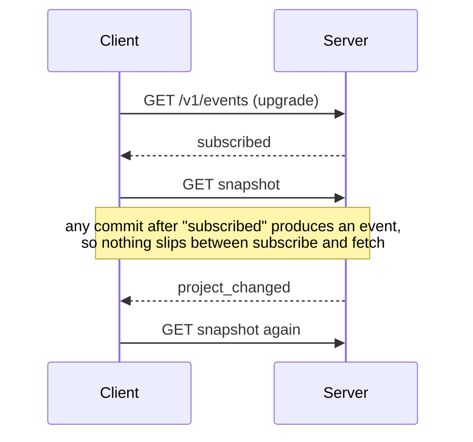

# Building story

How Hyakume is built, and why each part ended up the way it is. The
reasoning behind each choice, and what was rejected, is in
[decisions.md](decisions.md).

## The crates

Six crates in one Cargo workspace. Only `hyakume-desktop` depends on GPUI, so
a headless install carries no GPU or windowing libraries.

```text
crates/
├── hyakume-core/      # domain types and rules, /v1 wire types; no I/O
├── hyakume-storage/   # SQLite schema, migrations, queries (SQLx)
├── hyakume-client/    # local and remote workspaces behind one interface
├── hyakume-server/    # bin hyakume-server (Axum)
├── hyakume-cli/       # bin hyakume: the CLI, and the desktop app's launcher
└── hyakume-desktop/   # bin hyakume-desktop (GPUI)
```

```diagram
                  ┌────────────────┐
  hyakume ───────→│ hyakume-client │──→ local.db
  (no GPUI)       └───────┬────────┘
     ┃ no arguments:      │ REST/JSON + WebSocket
     ┃ exec               ▼
     ▼            hyakume-server ──→ server.db
  hyakume-desktop
  (GPUI)
```

`hyakume` with no arguments replaces itself with `hyakume-desktop`, found next
to its own binary first and on `PATH` second, or exits 127 if there is none.
Any other invocation is a CLI command. One command name works everywhere
([D1](decisions.md#d1-thin-hyakume-launcher-2026-10-24)). GPUI is pinned at
0.2.2, which needs libc held at 0.2.186
([D2](decisions.md#d2-gpui-022-and-the-libc-pin-2026-10-24)).

## The domain: `hyakume-core`

Plain types, plus the rules that must behave the same in the CLI, the server,
and the app:

- **Tasks** carry a `version`. Saves replace all of `TaskFields` at once,
  which is what makes a whole-task conflict check possible.
- **References** like `WEB-12` (project key plus a per-project number) are
  what people and agents type. UUIDv7 ids stay internal.
- **Blocking** is an indicator, never a lock. `unfinished_blockers` lists the
  "blocks" sources still in an unfinished stage. A blocker that isn't loaded
  counts as unfinished, so missing data can't hide one.
- **Permissions** go through one check:

```text
allows(permission, project)
  owner                      → yes (ownership is not a role)
  permission not in roles    → no  (roles add up; there are no deny rules)
  member                     → yes, in every project
  guest                      → only project-scoped permissions, only in invited projects
```

- **Names** compare through `name_key`, so `admin` and the preset `Admin`, or a
  custom "Blocks" and the built-in `blocks`, count as the same name. Storage
  refuses the duplicate, and the CLI refuses a name that matches two things
  instead of guessing ([D7](decisions.md#d7-names-match-the-way-people-type-them-2026-10-25)).
  A directed link type needs a reverse label ("depends on" / "needed by"), so
  it reads right from both ends.

**Shared text can't drive your terminal.** In a shared workspace anyone could
put an escape sequence in a title, such as OSC 52, which overwrites the
reader's clipboard. Two layers use `is_unsafe_char` (C0/C1 controls and bidi
overrides):

```diagram
write ──→ check_text in core/storage ━━▶ ● refused
             titles, labels, names: no unsafe characters
             descriptions, comments: newlines and tabs only

read  ──→ CLI text, canvas text, logs ━━▶ unsafe chars become �
          (servers may be older, or not ours)
```

The read side is the one that protects you, since a client also talks to
servers it doesn't control.

## Storage: one schema everywhere

`hyakume-storage` wraps one SQLite pool in WAL mode, with foreign keys on and
a 5 s busy timeout. `Store::open` migrates before returning, so nothing ever
holds a store with an old schema.

The local database and the server database share **one schema**. Local work is
a workspace with a single identity, "me", who owns it. Both sides run the same
queries and can't drift apart
([D3](decisions.md#d3-one-schema-for-local-and-server-databases-2026-10-24)).

Writes take the lock up front with `BEGIN IMMEDIATE`, because a transaction
that reads first and writes later can fail with `SQLITE_BUSY` instead of
waiting. The version check and the write happen in that one transaction:

```text
update_task(id, expected_version, fields)
  BEGIN IMMEDIATE
  current = select task
  if current.version ≠ expected_version → Conflict { latest: current }, nothing written
  check stage and assignee belong here
  write fields, version + 1
  COMMIT
```

`project_snapshot` returns a project's stages, tasks, relations, and stubs for
linked tasks in other projects, all in one read transaction. In WAL mode
that's one consistent view, so a task deleted mid-read can't fail the whole
snapshot. It used to: five separate queries raced deletes 145 times in 269
stress rounds. A relation leading into a project the reader can't see is
dropped, so a guest never learns the task exists.

**Positions go when their task goes.** A saved canvas position names a
task or a project, and one column can't be a foreign key into two tables,
so at first nothing removed it. Deleted tasks left their positions behind,
and every layout read sent them back. Migration 0002 clears the leftovers
and adds two triggers:

```text
DELETE task     → layouts_forget_task    → its position goes
DELETE project  → layouts_forget_project → its position goes
                  (its tasks cascade, and each fires the trigger above)
```

## The server

```text
request
  TraceLayer → RequestBodyLimit (1 MiB) → Timeout (30 s)
  Caller: Bearer token → SHA-256 → sessions row → identity
  handler: access check → one store operation → notify after commit
```

Denied reads return 404, not 403, so outsiders can't probe which ids exist.
Linking two tasks needs `manage_relations` in both projects, because the link
shows up in each.

**Events name changes, never content.** One WebSocket per client at
`/v1/events`. An event says what changed (`project_changed`,
`workspace_changed`, `layout_changed`), and the client refetches through the
normal permission-checked API. Visibility is checked again per event, so a
guest's socket never hears about other projects and a role change applies to
sockets already open ([D4](decisions.md#d4-events-name-changes-saves-check-versions-2026-10-24)).



**Dev login** (`dev_mode = true` only) issues real sessions for the listed
test identities, and refuses a non-loopback address unless told otherwise
([D5](decisions.md#d5-dev-login-and-credentials-2026-10-24-prototype-only)).

## Client and CLI

```text
OpenWorkspace
├── Local  { store, me }   → hyakume-storage directly
└── Remote(Remote)         → /v1 over reqwest, events over tokio-tungstenite
```

A **profile** is a data directory (`client.toml`, `local.db`, `cache.db`
for offline copies, and with the dev-file store, `credentials/`). `HYAKUME_DATA_DIR` picks one, which is how
Alice and Bob run side by side. Credentials go to the OS keyring. If it's
unreachable, sign-in fails with an explanation and writes nothing.

A connection can die without closing (a laptop asleep, a dropped NAT entry).
So the client pings the event stream every 20 s and gives up after 60 s of
silence, and a WebSocket handshake that never answers gives up after 30 s.
Either way the source goes offline and retries
([D10](decisions.md#d10-event-streams-are-pinged-2026-10-25)).

The CLI reads resource then action: `hyakume task move WEB-1 review`. Text
output is for people. `--json` and the exit codes are a contract, and parse
errors come out as JSON too. Edits save with the version they read. If
someone saved in between, the command exits 5 and prints the latest version,
so nothing is overwritten silently.

## Trying it

```text
mise run servers       dev servers a (7878) and b (7879); if one stops, both stop
mise run demo-setup    alice, bob, gwen profiles, signed in
mise run demo-data     the mockup's tasks, plus the 150-task Scale workspace
mise run alice         the app as Alice; `mise run alice -- task list` for the CLI
mise run reset         delete dev/data (stop the servers first)
```

Profiles use the `dev-file` credential store, so test sign-ins never touch the
OS keyring and `reset` removes every trace. **Scale** (projects APP, SRV, and
OPS, 50 tasks each, 86 links) is declared in `dev/server-b.toml` and filled by
the `scale_data` example of the CLI crate, which runs the CLI as Alice. It's
Rust rather than a shell script so the repository stays one language and CI
builds it. Its links follow fixed patterns rather than random picks, so every
run builds the same workspace. It exists to check that a real team's
tracker stays readable and fast.

## The desktop app

```text
crates/hyakume-desktop/src/
    ├── runtime.rs, sources.rs   # Tokio thread: local work + one loop per server
    ├── scene.rs                 # what to draw, rebuilt per update (no GPUI)
    ├── layout.rs                # where it goes; positions stick (no GPUI)
    ├── app.rs                   # root view: state, input, header, notes
    ├── app/writes.rs            # every change the window sends, and its answer
    ├── edit.rs                  # drafts: task form, conflict review, dialogs
    ├── canvas.rs                # camera, painting, hit testing, label placement
    ├── glyphs.rs                # eyes, webs, threads, text
    ├── inspector.rs             # the side panel for one task
    ├── keys.rs, picker.rs       # shortcuts, the palette
    ├── text_input.rs            # a text field, one line or several
    └── meme.rs, theme.rs        # Meme, light and dark palettes
```

### Two executors, two channels

reqwest and SQLx need Tokio, while GPUI runs its own executor on the main
thread. All network, keyring, and SQLite work lives on one Tokio thread, and
the window talks to it through two unbounded channels, which work from any
executor ([D8](decisions.md#d8-a-tokio-thread-and-a-painted-canvas-2026-10-25)).

```diagram
 GPUI main thread                       hyakume-io thread (Tokio)
┌──────────────────┐   Command        ┌─────────────────────────────┐
│ Hyakume (app.rs) │━━━━━━━━━━━━━━━━━▶│  ├─ run_local  ─→ local.db  │
│  Scene, Layout,  │  Retry, Detail,  │  ├─ run_server a ─→ :7878   │
│  camera, focus   │  Write, Layout   │  ├─ run_server b ─→ :7879   │
│                  │◀━━━━━━━━━━━━━━━━━│  └─ cache.db (offline copy) │
└──────────────────┘  Source, Wrote,  └─────────────────────────────┘
                      Notice
```

Each server loop subscribes, waits for `subscribed`, and only then loads.
After that it refetches only what an event names. An ended stream keeps the
data on screen and retries in 1, 2, 4 … 30 s. Local work has no server to
send events, so `ChangeWatcher` polls `PRAGMA data_version` on one dedicated
connection: that number only moves when a *different* connection commits,
such as the CLI.

### Scene, layout, paint

Every update rebuilds `Scene` from all sources: one column per workspace, a
web per project, an eye per task, a thread per link. A link between projects
shows up in both snapshots, so threads are deduplicated by relation id.

`Layout` keeps positions keyed by source plus id, and only places what's new.
A refresh never moves what you've already seen:

```text
place(scene)
  web radius   = stored, unless crowded (then grow, with slack)
  column x     = stored, never over the previous column
  column width = widest web, or wider for its names (below)
                 a column widened for names slides its webs right by half the growth
  web center   = stored, or below the last web; zigzag at most 60 off the middle
  eye position = stored, or a golden-angle slot, then push-apart / pull-along-links
```

One `canvas()` element paints the whole world, and hit testing is done by hand
against the same positions. Below 45% zoom eyes are dots; from 95% they carry
labels. Clicking a web opens it. Tasks it links to in other projects then sit
on small torn webs around it ("stubs"), and clicking one switches to that
project.

**Who owns the camera.** Until you pan, zoom, or select something, the view
keeps fitting itself, on new data and on window resizes. After that it's
yours. The arrow keys count too once they scroll the view: otherwise opening
and closing a project would refit from the top and lose the cursor. A window resize keeps the view's middle in place, but the details panel
opening or closing doesn't move the view, so a clicked task stays under the
pointer and a second click on it lets go of it.

### Readable at any size

Text keeps its pixel size while webs shrink, and a real tracker has hundreds of
tasks. Most of the canvas code follows from two rules: **nothing draws over
text**, and **a big workspace must still read**. A 150-task Scale workspace
drawn the old way was an unreadable tangle at 45 ms a frame
([D13](decisions.md#d13-threads-keep-clear-of-text-2026-10-26),
[D14](decisions.md#d14-links-at-scale-bundles-and-lighting-2026-10-26)).

**What gets drawn.** On the overview, links inside a project are hidden and
the links between two projects merge into one bundle with a count. An opened
project shows all its links, fainter the more there are. Whatever you hover or
select lights up with its links and the tasks at their other ends, and
everything else fades:

```text
spot  = hovered eye or web, else the selected task, else the arrow-key cursor
light(scene, spot)
  threads[i] = link i touches the spot
  if none → no light at all        # a task with no links doesn't flicker the view
  eyes[e]    = e is the spot's, or at the other end of a lit link
```

**Threads route around headings.** A thread is one quadratic curve, and
routing picks how far to pull its middle sideways. Web names, task counts,
and column headers are never crossed if any bend avoids them. On the
overview a thread also stays inside its workspace's column and steers around
webs between its ends:

```text
route(from, to)
  cost(bend) = samples (every 4 px) on a heading, a web in between, or outside the column
             + a small cost per pixel of bend, so the shortest clear bend wins
  try 0, ±12, ±24 … ±640 px; stop once bending alone costs more than the best
```

Labels don't take part in routing. Each sits on a plate filled with exactly
the colour under it, so lines simply pass behind the text. Web discs are
opaque for the same reason: a bundle passing behind a web is hidden there.
Arrowheads and link names are painted after the labels, and each end of a
thread stops at its eye's drawn outline (`glyphs::eye_edge` walks in along
the thread until it reaches the shape).

```diagram
dots → columns → bundles → webs → stubs → threads → labels on plates
     → arrowheads, pills → eyes → picked label → column headers
```

**Labels yield instead of piling up.** In a 50-task web there's no room for
every label, so `place_labels` gives each one a spot or leaves it out:

```text
order: picked (selected, hovered, Find's preview), then lit, then the rest
for each label
  try below, above, right, left, then the corners
  a spot is free if it covers no heading, eye, or placed label,
    and sits nearer its own eye than any other (or it reads as a neighbour's)
picked labels always show: one line when zoomed out, and if nothing near the eye
  stays clear of its linked tasks, a card just outside the web with a thin line to it
```

**Zoom stops before names collide.** Instead of hiding names, the view can't
zoom out past 80% of Fit, nor past the zoom where a web's name would touch the
web above it (never below 18%). Columns are widened until their names fit at
that zoom, and webs in a column sit 240 units apart. Widening only slides that
column's webs to its new middle and pushes later columns right. Nothing is
placed again, and the camera follows whatever you're looking at, so a long
project name arriving in a refresh doesn't throw an open project off screen. In a small window with a
very tall column, Fit therefore starts from the top and the rest is a scroll
away, which is why the button says "Fit" and not "Fit all"
([D15](decisions.md#d15-zoom-out-stops-near-fit-2026-10-26)).

**Smaller rules, same idea.**
- Column headers share one row. Scrolled down, they pin to the top on a band
  that everything passes under, and clicks on the band do nothing.
- Stubs stay out of the cones straight above and below their web, where its
  name and count sit. When crowded they space out evenly on a wider ring.
- Badges and selection rings are sized from the eye's body, not its 28-unit
  drawing box, so they stay attached when zoomed in.
- A bundle's count pill stays inside its column.
- An offline note sits under its column's webs when that's on screen.
  Otherwise it moves up under the first row of names, over that server's own
  greyed webs. It's never wider than its column; if the column is too narrow,
  it shows just its title and Retry.

### The keyboard

Everything works without a mouse, as PROJECT.md requires. GPUI matches a key
against the key contexts from the focused element up to the window, so each
shortcut lives in the context where it should work
([D11](decisions.md#d11-the-keyboard-map-2026-10-25)):

```diagram
Hyakume   Ctrl+Shift+P  Ctrl+F  Ctrl+= / Ctrl+-  Ctrl+0  Esc  Tab  Page Up/Down
 ├─ Canvas      ←↑↓→ move   Shift+←↑↓→ pan   Enter open   O / I follow links
 └─ Picker      ↑↓ / Tab move   Enter choose   Esc close
     └─ TextInput   ← → Home End  Ctrl+←/→  Backspace  Ctrl+A/C/X/V
```

Plain letters (O, I) only work on the canvas, so typing into Find never
triggers them. On the overview the arrows move between webs, and inside a
project between eyes:

```text
nearest(from, arrow, candidates)
  candidates ahead of `from` along the arrow; score = along + 2 × sideways
  best inside the 45° cone wins; nothing in the cone → best anywhere ahead
```

Escape steps back one level per press: an open edit form, then the details
together with their task (as clicking that task again does), then the opened
project, then the cursor. A task picked with the arrows and no details open
is let go on its own press. The palette (Ctrl+Shift+P) lists the commands
that apply right now, with their shortcuts, plus every project and workspace.
Find (Ctrl+F) uses the same list for tasks, fading the ones that don't match
until you pick one or press Escape.

**Focus never gets stranded.** Focus rings show only after a key press, like
`:focus-visible`. Buttons that vanish when used (breadcrumbs, or Retry when a
server comes back) would leave focus outside every context, and then GPUI runs
no shortcut at all. So `on_focus_lost` hands focus back to the canvas. Picking
from the palette always returns focus to the canvas, because Enter's key-up
would otherwise click a button. Escape returns it to wherever it was, such as
the Find button. Tab inside the details panel scrolls the focused link into
view.

**The text field.** GPUI 0.2.2 has none, so `text_input.rs` follows GPUI's
`input` example. The field scrolls sideways to keep the caret visible. It
reports the caret to the input method whenever the caret moves, empty field
included, because otherwise Japanese candidates open in a corner of the
screen.

### Stage filters

The palette lists "Hide tasks in Done", "Hide tasks in Backlog", and so on,
one entry per stage name. Picking one hides those tasks everywhere: every
project's Done goes together, and "done" or "DONE" counts as the same stage
([D17](decisions.md#d17-stage-filters-go-by-name-2026-10-26)). The header
then shows what's hidden, with a Show all button, so a filtered view is
never mistaken for an emptier workspace.

Hiding only changes what's drawn. Positions don't move, so the rest of the
web doesn't shuffle and a task comes back where it was:

```text
hidden[eye] = name_key(eye.stage) ∈ hidden stages
frame.eye_at(eye) = None if hidden[eye]      # one check, and then:
  not painted, not hit, not an arrow target, not in Find or Follow
  links and bundles count only links with both ends shown
  a web's count reads "5 of 6 tasks"
```

A hidden task can't stay selected, since its ring and details would point
at nothing on screen, so hiding its stage lets go of it.

### Your own shortcuts

A `keys.toml` next to `client.toml` adds to the defaults, and `false` removes
one. "Reload keyboard shortcuts" in the palette applies changes without a
restart ([D12](decisions.md#d12-your-own-shortcuts-in-keystoml-2026-10-25)).

```toml
[window]
ctrl-k = "OpenPalette"
ctrl-shift-p = false      # unbind the default

[canvas]
h = "MoveLeft"
l = "MoveRight"
```

Each entry is checked on its own. A bad one is skipped with a reason, and the
rest still loads. The checks catch an unknown section or action, an action
outside the section where it can fire, a typing key outside `[canvas]`, and a
misspelled key name. Hints in the palette and on buttons ask GPUI's live
keymap what each key would actually run, so they never advertise a key that
was removed or taken by something else:

```text
hint(action)
  for each binding of action, newest first:
    what would GPUI run for these keys where focus usually is? → action? show it
```

### Changing work

Step 8 made the window more than a viewer. Every change goes the same way:
the window sends a `Write` with a request number, the I/O thread runs it
through the same `OpenWorkspace` and `Remote` calls the CLI uses, and an
`Update::Wrote` comes back with that number
([D18](decisions.md#d18-the-window-edits-through-the-clis-calls-2026-10-26)).

```diagram
key or click ──▶ check: source live? role allows it? ──no──▶ notice, nothing sent
                    │ yes
                    ▼
     pending[request] = what it was for (draft kept)
                    │  Command::Write
                    ▼
     I/O thread: update_task / create_task / add_comment / create_relation …
                    │  Update::Wrote { request, result }
                    ▼
  Ok(task)        → put it on screen now; the change event refetches the rest
  Conflict(latest)→ review: latest and draft side by side
  Failed(why)     → the form shows why, and keeps the draft
```

**What you can do, and with which keys.** All of it also works from the
palette and, for the mouse, from buttons under a task's title.

```text
E  edit the task in the side panel     Ctrl+Enter saves, Esc cancels
N  new task in the project you're in   Enter in a one-line field saves too
M  move to a stage   A  assign   (palette: priority)
L  link: pick how it reads ("blocks", "blocked by"), then the other task
C  comment           (palette: remove a link)
P  pin or unpin      Alt+arrows nudge the selected eye (or a web on the overview)
Del  delete the task, after a question   Ctrl+Enter deletes, Esc keeps it
(palette: change someone's roles in a shared workspace)
```

**Deleting asks first.** Del opens a small dialog naming the task and
saying its links and comments go too, with no undo. Escape keeps the task,
since a stray key shouldn't cost work; Ctrl+Enter or the Delete button
deletes it. The task leaves the screen when the server answers, not before,
along with its links and any draft or comment box open on it.

**Roles from the palette.** "Change someone's roles in a / Acme" lists the
people with the roles each holds, then every role marked where they have it.
Picking one gives it, or takes it if they had it:

```text
palette ─▶ Change someone's roles in a / Acme
        ─▶ Bob         Member
        ─▶ Reviewer    (Member shows "Has it · Enter takes it")
        ─▶ SetRoles { bob, [Member, Reviewer] }  ─▶ "Gave Bob the Reviewer role"
```

The server takes the whole set, so the window sends the roles the person
had when last loaded, plus or minus the one picked. Two admins changing
the same person's roles at the same moment could undo each other's pick;
the change event right after shows what stuck. Local work has no roles.

The form takes its stage, assignee, and priority from the palette instead of
drop-downs, since the palette is already searchable and keyboard-driven.
Picked while the form is on screen, they change the draft; otherwise the
change saves straight away against the version on screen. A draft left open
on another task (you moved on with Find, say) waits there untouched, so a
quick change never lands in a form you can't see. Enter adds a line in a
description or comment, and submits from any one-line field.

Whenever the form puts the caret in its title, the panel scrolls back to
the top first. It may still be scrolled down to the comment box, and typing
into a title nobody can see would change it unnoticed.

**Typing while a save is on its way.** The form stays editable while it
saves, so the answer can find it changed. Each pending write keeps what it
sent, and the answer compares:

```text
answer to a save from the form
  form still holds exactly what was sent ─▶ close it
  form was typed into since             ─▶ keep it open, now based on
                                            the version just saved
  refused, someone saved first          ─▶ review shows the form as it is now,
                                            and "Keep editing" brings back that
                                            same form, not the copy that was sent
```

A new task works the same way: if the form changed while it was being
created, it turns into an edit of the new task with the extra text still in
it. Comments follow the same rule: a posted comment clears its box only if
the box still holds what was sent. Until the answer comes, a second
Ctrl+Enter on the same text does nothing, so a double press can't post it
twice. The answer reloads the comments only if that task is still open:
reloading another one would replace the request of the task open now, which
would then be stuck on "Loading comments…". A dialog's answer only touches the dialog
that sent it; if that one was cancelled and another opened, the newer
dialog is left alone and the result shows as a notice.

**Labels go one per line.** A label may contain a comma ("design,
research"), but never a newline, since the server refuses control
characters in labels. So the labels field is a small multiline field with
one label per line, and saving any other field hands back exactly the
labels it was given.

**Conflicts.** A save names the version it started from. If someone saved in
between, the server refuses it as a whole and sends the task as it is now.
The review shows both, marks the fields that differ, and stacks them in a
narrow window. "Keep editing my draft" puts the draft back in the form,
now based on the latest version, so the next save goes through unless
someone beats it again. Escape does the same: losing a draft takes a
deliberate click on "Discard my draft".

**Read-only.** A source that isn't live is read-only: the panel says
"Offline, read-only", the shortcuts explain why instead of acting, and a
draft already open keeps its text and shows why it can't save. A role that
can only view gets a "Read-only" chip and no edit buttons. The server
checks permissions again either way; the window just doesn't offer what
would be refused.

**The multiline field.** `text_input.rs` grew a multiline mode for
descriptions, labels, and comments. GPUI's `shape_text` splits the text at
newlines and wraps each paragraph to the field's width. The field keeps
where each paragraph starts in the text and on screen, which is all that
clicks, the caret, Up and Down, selection bands, and the input method need.
It shows a set number of rows (six, three for labels) and scrolls to keep
the caret in view.

### Placing things by hand

Inside a project, dragging an eye moves it on its web. On the overview a
plain drag always pans, since webs cover most of it; Ctrl+drag picks up the
web or eye under the pointer and moves it. The first plain drag that starts
on a web says so in a notice. Either way the node is pinned, which a small
dot on its upper left shows, and Re-layout places everything else again
around it.

```text
drag / Alt+arrows / P ─▶ Layout.move_* (pins) ─▶ SaveLayout ─▶ server or local.db
                                                                  │
other device ◀── LayoutChanged event ◀────────────────────────────┘
     └─ refetch layout ─▶ apply_saved: a node it hasn't applied yet moves
```

Positions are personal. A server project's are stored on that server under
your identity, so they follow you to your other devices and nobody else
sees them. Local projects' stay in local.db, and move to another computer
with the rest of local work (see [Moving local work](#moving-local-work)).

A saved position comes back to the device that saved it, and an older
one can still be on its way when it does: a refresh fetched just before
the save landed, or the echo of the previous nudge. Two rules keep those
from dragging the eye back. Saves to one source go one at a time, in the
order they were made, and whatever piles up during a save goes out as one
batch with only the latest spot per node. The layout also remembers what
it last sent per node, and until that exact value comes back, any other
saved value for the node is older and is skipped:

```text
Alt+← ×3 ─▶ sent[WEB-1] = third spot
               │
               ▼
queue for server a ─▶ first spot ─▶ (second + third, batched) ─▶ third spot
               │
echo of the first spot  ─▶ ≠ sent ─▶ skipped, it's older
echo of the third spot  ━▶ = sent ━▶ applied, sent cleared
                                      later moves from other devices land again
```

A save that fails clears its `sent` entry, since its echo will never come.

Re-layout moves every node that isn't pinned, including ones saved
unpinned with P, and saves where those went. Without that, a restart or
another device would put them back where they were. A web also keeps room
for its pinned eyes: one that lost most of its tasks shrinks no further
than its furthest pinned eye, which would otherwise be pulled inward.

A pinned web is never moved by placement either. Webs that aren't pinned
are pushed down past it, a column grows to hold it where it was put, and
widening a column for its names slides only the unpinned webs:

```diff
 place(column)
   width = widest web, or the names
+          or a pinned web's x + radius + room
   for each web, top to bottom
-    push below the one above
+    pinned → stays exactly where it was put
+    else   → push below the one above, then below any pinned web it meets
 widen(column)
-  slide every web by half the growth
+  slide every unpinned web by half the growth
```

### Offline copies

Each server's workspaces, layouts included, are written to `cache.db` after
every load. On the next start that copy shows while the server connects,
and stays up greyed and read-only if it doesn't answer
([D19](decisions.md#d19-offline-copies-in-cachedb-2026-10-26)). The copy is
keyed by server URL and signed-in identity, so renaming a server in
client.toml or signing in as someone else never shows another person's
copy. Like local.db, it lives in the data directory, which Hyakume keeps
owner-only (0700), so other users on the computer can't read the copies.
A new directory is created that way. One an older build left at 0755 is
tightened the next time the profile opens, as long as you own it.
The key is read once, when a connection signs in, together with its
token: if the CLI signs the same profile in as someone else while the app
is connected, the app's data still goes under the identity it was fetched
as.

Comments are kept for the tasks you open. Each time the panel loads a
task from a server, the answer is saved in `cache.db` next to the copy.
Offline, the panel shows that saved answer with when it was saved:

```text
open a task ─▶ source live?  ─yes─▶ server ─▶ show it, save it under (key, task)
                    │ no                 └─ unreachable ─┐
                    ▼                                    ▼
             saved answer for (key, task)? ─yes─▶ "Comments as of Oct 27, 12:38 AM …"
                    │ no
                    ▼
             "Comments aren't available: a isn't connected"
```

Only reaching the server falls back; a refusal or a deleted task never
shows the old copy. The same goes for the workspaces themselves: when the
server says the session isn't valid, or the source fails for any reason
other than not reaching the server, the copy leaves the screen and the
column shows only "Not signed in" (or the error) and Retry. When the workspace copy is replaced, comments of tasks
no longer in it go too, so lost access or a deletion leaves nothing behind.
The window tells the I/O thread a source is offline, so it reads the copy
straight away instead of waiting out a five-second connect timeout.

### Moving local work

Local work lives in local.db on one computer. `hyakume local export FILE`
writes all of it to one JSON file: projects, stages, tasks, comments, link
types, links, and your positions on its canvas. `hyakume local import FILE`
on the other computer puts it there
([D21](decisions.md#d21-local-work-moves-by-file-2026-10-27)).

```diagram
laptop                                   desktop
local.db ──export──▶ work.json ━━carry━━▶ import ──▶ local.db
                    (0600, format 1)        ┃
                                            ┣━ ids kept: links and positions still match
                                            ┣━ "me" in the file → this computer's "me"
                                            ┗━ built-in link types → this computer's own
```

An import never merges. Into empty local work it just goes in. If local
work has projects, it needs `--replace`, which asks first (or takes
`--yes`) and deletes what's there. The whole import is one transaction: a
file that breaks a rule, like a link to a task it doesn't hold, changes
nothing. Every field goes through the same checks as a normal save, since
a file is input like any other. A file from a newer format is refused by
its format number before anything else is read. The desktop app sees an
import like any other commit to local.db and redraws.

The export file is the person's own work, so it's written 0600. Opening
with that mode only sets it on a new file, so an export over an existing
one also sets the mode on the open file before writing anything into it.

### Meme

Meme is painted with `PathBuilder` from the mockup's geometry, not shipped as
SVG. GPUI 0.2.2 doesn't swap SVG pixels from RGBA to BGRA, so the gold eye came
out blue. Painting Meme like the eyes also lets the theme colour it. A test
pins the 99 small eyes.

### Performance

With 150 tasks and labels showing, a frame takes about 2 ms in a release build
and about 1 ms in a debug build. The debug number is low because libraries
compile optimized even in debug builds; without that, GPUI's text shaping made
frames 25 ms ([D16](decisions.md#d16-libraries-optimized-in-debug-builds-2026-10-26)).
Labels and routes are computed fresh each frame. Caching them would add stale
drawings as a risk with no time left to save.

## How it's checked

- **CI** (`mise run ci`, also on GitHub Actions): formatting, Clippy with
  warnings denied, and every test. Tests cover behaviour that would really
  break: version conflicts, permission and event visibility, the change
  watcher, offline copies replaced per identity, offline comments pruned
  with their task, local work carried whole between two databases (and
  refused or rolled back whole), positions removed with
  their task, pins surviving re-layout, synced positions applied once,
  a profile directory left open by an older build closed to 0700,
  an older save's echo never undoing a newer move, pinned eyes kept in
  place when their web shrinks, re-layout handing back what it moved,
  label and due-date parsing, stable layouts, arrow-key neighbours, keymap rules and hints, link
  lighting and bundling, routing around text and inside columns, stub spacing,
  zoom anchoring, and thread ends meeting drawn outlines. Where it was
  practical, a new test was first shown to fail on the old code.
- **The real app**, driven on a private X11 display (Xvfb, software Vulkan,
  xdotool) against copies of the demo on separate ports. This sends real
  pointer and key events, including key-ups, which GPUI keeps private from
  in-process hooks. It covers both themes, every zoom from fit to 300%, the
  offline paths, and input-method placement with Fcitx/Mozc.
- **Not covered automatically:** smoothness on a real GPU, and input methods
  under Wayland.
