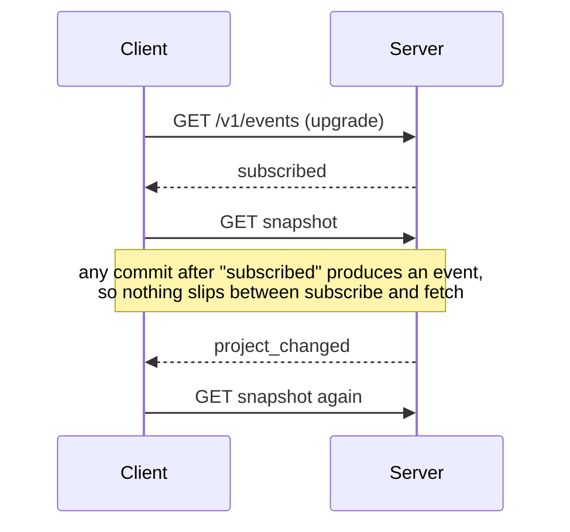

# Building story

How Hyakume is built, and why each part ended up the way it is. The
reasoning behind each choice, and what was rejected, is in
[decisions.md](decisions.md).

## The crates

Six crates in one Cargo workspace. Only `hyakume-desktop` depends on GPUI, so
a headless install carries no GPU or windowing libraries.

```text
crates/
├── hyakume-core/      # domain types and rules, /v1 wire types; no I/O
├── hyakume-storage/   # SQLite schema, migrations, queries (SQLx)
├── hyakume-client/    # local and remote workspaces behind one interface
├── hyakume-server/    # bin hyakume-server (Axum)
├── hyakume-cli/       # bin hyakume: the CLI, and the desktop app's launcher
└── hyakume-desktop/   # bin hyakume-desktop (GPUI)
```

```diagram
                  ┌────────────────┐
  hyakume ───────→│ hyakume-client │──→ local.db
  (no GPUI)       └───────┬────────┘
     ┃ no arguments:      │ REST/JSON + WebSocket
     ┃ exec               ▼
     ▼            hyakume-server ──→ server.db
  hyakume-desktop
  (GPUI)
```

`hyakume` with no arguments replaces itself with `hyakume-desktop`, found next
to its own binary first and on `PATH` second, or exits 127 if there is none.
Any other invocation is a CLI command. One command name works everywhere
([D1](decisions.md#d1-thin-hyakume-launcher-2026-10-24)). GPUI is pinned at
0.2.2, which needs libc held at 0.2.186
([D2](decisions.md#d2-gpui-022-and-the-libc-pin-2026-10-24)).

## The domain: `hyakume-core`

Plain types, plus the rules that must behave the same in the CLI, the server,
and the app:

- **Tasks** carry a `version`. Saves replace all of `TaskFields` at once,
  which is what makes a whole-task conflict check possible.
- **References** like `WEB-12` (project key plus a per-project number) are
  what people and agents type. UUIDv7 ids stay internal.
- **Blocking** is an indicator, never a lock. `unfinished_blockers` lists the
  "blocks" sources still in an unfinished stage. A blocker that isn't loaded
  counts as unfinished, so missing data can't hide one.
- **Permissions** go through one check:

```text
allows(permission, project)
  owner                      → yes (ownership is not a role)
  permission not in roles    → no  (roles add up; there are no deny rules)
  member                     → yes, in every project
  guest                      → only project-scoped permissions, only in invited projects
```

- **Names** compare through `name_key`, so `admin` and the preset `Admin`, or a
  custom "Blocks" and the built-in `blocks`, count as the same name. Storage
  refuses the duplicate, and the CLI refuses a name that matches two things
  instead of guessing ([D7](decisions.md#d7-names-match-the-way-people-type-them-2026-10-25)).
  A directed link type needs a reverse label ("depends on" / "needed by"), so
  it reads right from both ends.

**Shared text can't drive your terminal.** In a shared workspace anyone could
put an escape sequence in a title, such as OSC 52, which overwrites the
reader's clipboard. Two layers use `is_unsafe_char` (C0/C1 controls and bidi
overrides):

```diagram
write ──→ check_text in core/storage ━━▶ ● refused
             titles, labels, names: no unsafe characters
             descriptions, comments: newlines and tabs only

read  ──→ CLI text, canvas text, logs ━━▶ unsafe chars become �
          (servers may be older, or not ours)
```

The read side is the one that protects you, since a client also talks to
servers it doesn't control.

## Storage: one schema everywhere

`hyakume-storage` wraps one SQLite pool in WAL mode, with foreign keys on and
a 5 s busy timeout. `Store::open` migrates before returning, so nothing ever
holds a store with an old schema.

The local database and the server database share **one schema**. Local work is
a workspace with a single identity, "me", who owns it. Both sides run the same
queries and can't drift apart
([D3](decisions.md#d3-one-schema-for-local-and-server-databases-2026-10-24)).

Writes take the lock up front with `BEGIN IMMEDIATE`, because a transaction
that reads first and writes later can fail with `SQLITE_BUSY` instead of
waiting. The version check and the write happen in that one transaction:

```text
update_task(id, expected_version, fields)
  BEGIN IMMEDIATE
  current = select task
  if current.version ≠ expected_version → Conflict { latest: current }, nothing written
  check stage and assignee belong here
  write fields, version + 1
  COMMIT
```

`project_snapshot` returns a project's stages, tasks, relations, and stubs for
linked tasks in other projects, all in one read transaction. In WAL mode
that's one consistent view, so a task deleted mid-read can't fail the whole
snapshot. It used to: five separate queries raced deletes 145 times in 269
stress rounds. A relation leading into a project the reader can't see is
dropped, so a guest never learns the task exists.

**Positions go when their task goes.** A saved canvas position names a
task or a project, and one column can't be a foreign key into two tables,
so at first nothing removed it. Deleted tasks left their positions behind,
and every layout read sent them back. Migration 0002 clears the leftovers
and adds two triggers:

```text
DELETE task     → layouts_forget_task    → its position goes
DELETE project  → layouts_forget_project → its position goes
                  (its tasks cascade, and each fires the trigger above)
```

## The server

```text
request
  TraceLayer → RequestBodyLimit (1 MiB) → Timeout (30 s)
  Caller: Bearer token → SHA-256 → sessions row → identity
  handler: access check → one store operation → notify after commit
```

Denied reads return 404, not 403, so outsiders can't probe which ids exist.
Linking two tasks needs `manage_relations` in both projects, because the link
shows up in each.

**Events name changes, never content.** One WebSocket per client at
`/v1/events`. An event says what changed (`project_changed`,
`workspace_changed`, `layout_changed`), and the client refetches through the
normal permission-checked API. Visibility is checked again per event, so a
guest's socket never hears about other projects and a role change applies to
sockets already open ([D4](decisions.md#d4-events-name-changes-saves-check-versions-2026-10-24)).



**Dev login** (`dev_mode = true` only) issues real sessions for the listed
test identities, and refuses a non-loopback address unless told otherwise
([D5](decisions.md#d5-dev-login-and-credentials-2026-10-24-prototype-only)).

## Client and CLI

```text
OpenWorkspace
├── Local  { store, me }   → hyakume-storage directly
└── Remote(Remote)         → /v1 over reqwest, events over tokio-tungstenite
```

A **profile** is a data directory (`client.toml`, `local.db`, and with the
dev-file store, `credentials/`). `HYAKUME_DATA_DIR` picks one, which is how
Alice and Bob run side by side. Credentials go to the OS keyring. If it's
unreachable, sign-in fails with an explanation and writes nothing.

A connection can die without closing (a laptop asleep, a dropped NAT entry).
So the client pings the event stream every 20 s and gives up after 60 s of
silence, and a WebSocket handshake that never answers gives up after 30 s.
Either way the source goes offline and retries
([D10](decisions.md#d10-event-streams-are-pinged-2026-10-25)).

The CLI reads resource then action: `hyakume task move WEB-1 review`. Text
output is for people. `--json` and the exit codes are a contract, and parse
errors come out as JSON too. Edits save with the version they read. If
someone saved in between, the command exits 5 and prints the latest version,
so nothing is overwritten silently.

## Trying it

```text
mise run servers       dev servers a (7878) and b (7879); if one stops, both stop
mise run demo-setup    alice, bob, gwen profiles, signed in
mise run demo-data     the mockup's tasks, plus the 150-task Scale workspace
mise run alice         the app as Alice; `mise run alice -- task list` for the CLI
mise run reset         delete dev/data (stop the servers first)
```

Profiles use the `dev-file` credential store, so test sign-ins never touch the
OS keyring and `reset` removes every trace. **Scale** (projects APP, SRV, and
OPS, 50 tasks each, 86 links) is declared in `dev/server-b.toml` and filled by
the `scale_data` example of the CLI crate, which runs the CLI as Alice. It's
Rust rather than a shell script so the repository stays one language and CI
builds it. Its links follow fixed patterns rather than random picks, so every
run builds the same workspace. It exists to check that a real team's
tracker stays readable and fast.

## The desktop app

```text
crates/hyakume-desktop/src/
    ├── runtime.rs, sources.rs   # Tokio thread: local work + one loop per server
    ├── scene.rs                 # what to draw, rebuilt per update (no GPUI)
    ├── layout.rs                # where it goes; positions stick (no GPUI)
    ├── app.rs                   # root view: state, input, header, notes
    ├── canvas.rs                # camera, painting, hit testing, label placement
    ├── glyphs.rs                # eyes, webs, threads, text
    ├── inspector.rs             # the side panel for one task
    ├── keys.rs, picker.rs       # shortcuts, the palette
    ├── text_input.rs            # a one-line text field
    └── meme.rs, theme.rs        # Meme, light and dark palettes
```

### Two executors, two channels

reqwest and SQLx need Tokio, while GPUI runs its own executor on the main
thread. All network, keyring, and SQLite work lives on one Tokio thread, and
the window talks to it through two unbounded channels, which work from any
executor ([D8](decisions.md#d8-a-tokio-thread-and-a-painted-canvas-2026-10-25)).

```diagram
 GPUI main thread                       hyakume-io thread (Tokio)
┌──────────────────┐   Command        ┌─────────────────────────────┐
│ Hyakume (app.rs) │━━━━━━━━━━━━━━━━━▶│  ├─ run_local  ─→ local.db  │
│  Scene, Layout,  │  Retry, Detail   │  ├─ run_server a ─→ :7878   │
│  camera, focus   │◀━━━━━━━━━━━━━━━━━│  └─ run_server b ─→ :7879   │
└──────────────────┘   Update         └─────────────────────────────┘
```

Each server loop subscribes, waits for `subscribed`, and only then loads.
After that it refetches only what an event names. An ended stream keeps the
data on screen and retries in 1, 2, 4 … 30 s. Local work has no server to
send events, so `ChangeWatcher` polls `PRAGMA data_version` on one dedicated
connection: that number only moves when a *different* connection commits,
such as the CLI.

### Scene, layout, paint

Every update rebuilds `Scene` from all sources: one column per workspace, a
web per project, an eye per task, a thread per link. A link between projects
shows up in both snapshots, so threads are deduplicated by relation id.

`Layout` keeps positions keyed by source plus id, and only places what's new.
A refresh never moves what you've already seen:

```text
place(scene)
  web radius   = stored, unless crowded (then grow, with slack)
  column x     = stored, never over the previous column
  column width = widest web, or wider for its names (below)
                 a column widened for names slides its webs right by half the growth
  web center   = stored, or below the last web; zigzag at most 60 off the middle
  eye position = stored, or a golden-angle slot, then push-apart / pull-along-links
```

One `canvas()` element paints the whole world, and hit testing is done by hand
against the same positions. Below 45% zoom eyes are dots; from 95% they carry
labels. Clicking a web opens it. Tasks it links to in other projects then sit
on small torn webs around it ("stubs"), and clicking one switches to that
project.

**Who owns the camera.** Until you pan, zoom, or select something, the view
keeps fitting itself, on new data and on window resizes. After that it's
yours. The arrow keys count too once they scroll the view: otherwise opening
and closing a project would refit from the top and lose the cursor. A window resize keeps the view's middle in place, but the details panel
opening or closing doesn't move the view, so a clicked task stays under the
pointer and a second click on it lets go of it.

### Readable at any size

Text keeps its pixel size while webs shrink, and a real tracker has hundreds of
tasks. Most of the canvas code follows from two rules: **nothing draws over
text**, and **a big workspace must still read**. A 150-task Scale workspace
drawn the old way was an unreadable tangle at 45 ms a frame
([D13](decisions.md#d13-threads-keep-clear-of-text-2026-10-26),
[D14](decisions.md#d14-links-at-scale-bundles-and-lighting-2026-10-26)).

**What gets drawn.** On the overview, links inside a project are hidden and
the links between two projects merge into one bundle with a count. An opened
project shows all its links, fainter the more there are. Whatever you hover or
select lights up with its links and the tasks at their other ends, and
everything else fades:

```text
spot  = hovered eye or web, else the selected task, else the arrow-key cursor
light(scene, spot)
  threads[i] = link i touches the spot
  if none → no light at all        # a task with no links doesn't flicker the view
  eyes[e]    = e is the spot's, or at the other end of a lit link
```

**Threads route around headings.** A thread is one quadratic curve, and
routing picks how far to pull its middle sideways. Web names, task counts,
and column headers are never crossed if any bend avoids them. On the
overview a thread also stays inside its workspace's column and steers around
webs between its ends:

```text
route(from, to)
  cost(bend) = samples (every 4 px) on a heading, a web in between, or outside the column
             + a small cost per pixel of bend, so the shortest clear bend wins
  try 0, ±12, ±24 … ±640 px; stop once bending alone costs more than the best
```

Labels don't take part in routing. Each sits on a plate filled with exactly
the colour under it, so lines simply pass behind the text. Web discs are
opaque for the same reason: a bundle passing behind a web is hidden there.
Arrowheads and link names are painted after the labels, and each end of a
thread stops at its eye's drawn outline (`glyphs::eye_edge` walks in along
the thread until it reaches the shape).

```diagram
dots → columns → bundles → webs → stubs → threads → labels on plates
     → arrowheads, pills → eyes → picked label → column headers
```

**Labels yield instead of piling up.** In a 50-task web there's no room for
every label, so `place_labels` gives each one a spot or leaves it out:

```text
order: picked (selected, hovered, Find's preview), then lit, then the rest
for each label
  try below, above, right, left, then the corners
  a spot is free if it covers no heading, eye, or placed label,
    and sits nearer its own eye than any other (or it reads as a neighbour's)
picked labels always show: one line when zoomed out, and if nothing near the eye
  stays clear of its linked tasks, a card just outside the web with a thin line to it
```

**Zoom stops before names collide.** Instead of hiding names, the view can't
zoom out past 80% of Fit, nor past the zoom where a web's name would touch the
web above it (never below 18%). Columns are widened until their names fit at
that zoom, and webs in a column sit 240 units apart. Widening only slides that
column's webs to its new middle and pushes later columns right. Nothing is
placed again, and the camera follows whatever you're looking at, so a long
project name arriving in a refresh doesn't throw an open project off screen. In a small window with a
very tall column, Fit therefore starts from the top and the rest is a scroll
away, which is why the button says "Fit" and not "Fit all"
([D15](decisions.md#d15-zoom-out-stops-near-fit-2026-10-26)).

**Smaller rules, same idea.**
- Column headers share one row. Scrolled down, they pin to the top on a band
  that everything passes under, and clicks on the band do nothing.
- Stubs stay out of the cones straight above and below their web, where its
  name and count sit. When crowded they space out evenly on a wider ring.
- Badges and selection rings are sized from the eye's body, not its 28-unit
  drawing box, so they stay attached when zoomed in.
- A bundle's count pill stays inside its column.
- An offline note sits under its column's webs when that's on screen.
  Otherwise it moves up under the first row of names, over that server's own
  greyed webs. It's never wider than its column; if the column is too narrow,
  it shows just its title and Retry.

### The keyboard

Everything works without a mouse, as PROJECT.md requires. GPUI matches a key
against the key contexts from the focused element up to the window, so each
shortcut lives in the context where it should work
([D11](decisions.md#d11-the-keyboard-map-2026-10-25)):

```diagram
Hyakume   Ctrl+Shift+P  Ctrl+F  Ctrl+= / Ctrl+-  Ctrl+0  Esc  Tab  Page Up/Down
 ├─ Canvas      ←↑↓→ move   Shift+←↑↓→ pan   Enter open   O / I follow links
 └─ Picker      ↑↓ / Tab move   Enter choose   Esc close
     └─ TextInput   ← → Home End  Ctrl+←/→  Backspace  Ctrl+A/C/X/V
```

Plain letters (O, I) only work on the canvas, so typing into Find never
triggers them. On the overview the arrows move between webs, and inside a
project between eyes:

```text
nearest(from, arrow, candidates)
  candidates ahead of `from` along the arrow; score = along + 2 × sideways
  best inside the 45° cone wins; nothing in the cone → best anywhere ahead
```

Escape steps back one level per press: details, then the selection, then the
opened project, then the cursor. The palette (Ctrl+Shift+P) lists the commands
that apply right now, with their shortcuts, plus every project and workspace.
Find (Ctrl+F) uses the same list for tasks, fading the ones that don't match
until you pick one or press Escape.

**Focus never gets stranded.** Focus rings show only after a key press, like
`:focus-visible`. Buttons that vanish when used (breadcrumbs, or Retry when a
server comes back) would leave focus outside every context, and then GPUI runs
no shortcut at all. So `on_focus_lost` hands focus back to the canvas. Picking
from the palette always returns focus to the canvas, because Enter's key-up
would otherwise click a button. Escape returns it to wherever it was, such as
the Find button. Tab inside the details panel scrolls the focused link into
view.

**The text field.** GPUI 0.2.2 has none, so `text_input.rs` follows GPUI's
`input` example. The field scrolls sideways to keep the caret visible. It
reports the caret to the input method whenever the caret moves, empty field
included, because otherwise Japanese candidates open in a corner of the
screen.

### Your own shortcuts

A `keys.toml` next to `client.toml` adds to the defaults, and `false` removes
one. "Reload keyboard shortcuts" in the palette applies changes without a
restart ([D12](decisions.md#d12-your-own-shortcuts-in-keystoml-2026-10-25)).

```toml
[window]
ctrl-k = "OpenPalette"
ctrl-shift-p = false      # unbind the default

[canvas]
h = "MoveLeft"
l = "MoveRight"
```

Each entry is checked on its own. A bad one is skipped with a reason, and the
rest still loads. The checks catch an unknown section or action, an action
outside the section where it can fire, a typing key outside `[canvas]`, and a
misspelled key name. Hints in the palette and on buttons ask GPUI's live
keymap what each key would actually run, so they never advertise a key that
was removed or taken by something else:

```text
hint(action)
  for each binding of action, newest first:
    what would GPUI run for these keys where focus usually is? → action? show it
```

### Meme

Meme is painted with `PathBuilder` from the mockup's geometry, not shipped as
SVG. GPUI 0.2.2 doesn't swap SVG pixels from RGBA to BGRA, so the gold eye came
out blue. Painting Meme like the eyes also lets the theme colour it. A test
pins the 99 small eyes.

### Performance

With 150 tasks and labels showing, a frame takes about 2 ms in a release build
and about 1 ms in a debug build. The debug number is low because libraries
compile optimized even in debug builds; without that, GPUI's text shaping made
frames 25 ms ([D16](decisions.md#d16-libraries-optimized-in-debug-builds-2026-10-26)).
Labels and routes are computed fresh each frame. Caching them would add stale
drawings as a risk with no time left to save.

## How it's checked

- **CI** (`mise run ci`, also on GitHub Actions): formatting, Clippy with
  warnings denied, and every test. Tests cover behaviour that would really
  break: version conflicts, permission and event visibility, the change
  watcher, stable layouts, arrow-key neighbours, keymap rules and hints, link
  lighting and bundling, routing around text and inside columns, stub spacing,
  zoom anchoring, and thread ends meeting drawn outlines. Where it was
  practical, a new test was first shown to fail on the old code.
- **The real app**, driven on a private X11 display (Xvfb, software Vulkan,
  xdotool) against copies of the demo on separate ports. This sends real
  pointer and key events, including key-ups, which GPUI keeps private from
  in-process hooks. It covers both themes, every zoom from fit to 300%, the
  offline paths, and input-method placement with Fcitx/Mozc.
- **Not covered automatically:** smoothness on a real GPU, and input methods
  under Wayland.
